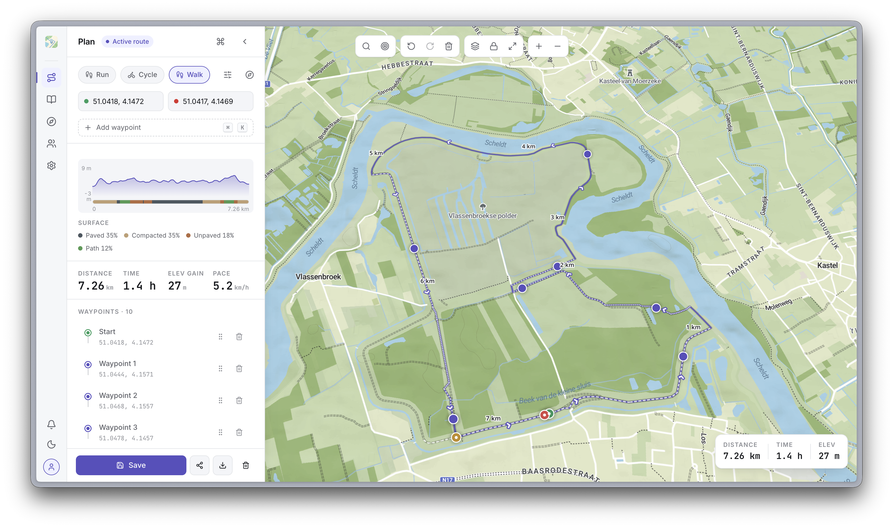

# routess

[](LICENSE)
[](https://github.com/robbeverhelst/routess/actions/workflows/ci.yml)
[](https://github.com/robbeverhelst/routess/releases)
[](https://docs.routess.com)

Route-planning app for cyclists, runners, and hikers. Interactive map editor, GPX import/export, and a personal route library. Open source, self-hostable, and also available as a hosted service.



📚 **Full documentation: [docs.routess.com](https://docs.routess.com)**

## Try it locally (self-host, 5 minutes)

```bash
git clone https://github.com/robbeverhelst/routess.git
cd routess
cp docker/.env.selfhost.example .env
# fill in the required secrets, GOOGLE_CLIENT_ID, GOOGLE_CLIENT_SECRET, VITE_MAPBOX_ACCESS_TOKEN and VALHALLA_URL
docker compose -f docker/compose.selfhost.yaml --project-directory . up -d
```

Then open <http://localhost:8080>.

See [`docs/operations/self-host`](https://docs.routess.com/docs/operations/self-host) for the full walkthrough (OAuth setup, optional services, Helm/Kubernetes path, TLS).

## What you need

Minimum to run routess:

- A **Mapbox access token** (free tier is fine)
- A **Valhalla** routing engine (`VALHALLA_URL`). Route calculation and surface analysis go through it; without it the routing endpoints return 503
- **Secrets**: `JWT_SECRET`, `ANALYTICS_SALT`, `PAT_PEPPER` and `DB_PASSWORD` (long random strings)
- A **Google OAuth client** (`GOOGLE_CLIENT_ID`/`GOOGLE_CLIENT_SECRET`). The API also supports email + password sign-in, but the self-host compose file currently requires both Google variables to be set

Optional services degrade gracefully when unset: Resend (email; without it verification links are logged to API stdout), Sentry/GlitchTip (error reporting), Umami (product analytics), Prometheus (metrics).

## Develop on routess

```bash
bun install
cp .env.example .env
bun dev
```

Defaults: web `:5173`, API `:3000`, docs `:3001`, Postgres `:5432`, pgAdmin `:5050`. Ports auto-shift if taken. Full dev guide: [`docs/getting-started/local-setup`](https://docs.routess.com/docs/getting-started/local-setup).

```bash
bun run lint:check   # bun lint + Biome (a11y and the rules bun lint lacks)
bun run check-types  # tsc across all workspaces
bun run test         # all tests
bun run ci           # full pipeline (postgres + format:check + lint:check + check:bun-native + check-types + build + test)
```

Run `bun run` with no arguments to list every script.

## Project layout

```
routess/
├── apps/
│   ├── web/            # React + Vite + Tailwind + Mapbox
│   ├── api/            # NestJS + PostgreSQL + MikroORM
│   ├── cli/            # `routess` CLI (npm)
│   ├── docs/           # Next.js (Fumadocs)
│   └── landing/        # Next.js marketing site and public route pages
├── packages/
│   ├── core/           # @routess/core           — shared business logic & state
│   ├── api-client/     # @routess/api-client     — type-safe API client
│   ├── i18n/           # @routess/i18n           — internationalization
│   └── design-tokens/  # @routess/design-tokens  — design system
├── charts/routess/     # Helm chart
└── docker/             # buildx bake + dev/self-host compose files
```

## Tech stack

| Layer    | Technology                                              |
|----------|---------------------------------------------------------|
| Frontend | React, TypeScript, Vite, Tailwind, Mapbox GL            |
| Backend  | NestJS, PostgreSQL, MikroORM, OpenTelemetry             |
| Docs     | Next.js, Fumadocs                                       |
| Build    | Bun workspaces, Biome, Docker Buildx Bake               |
| Deploy   | Helm, Kubernetes, GitHub Actions, semantic-release      |

## Architecture

The domain glossary lives in [`CONTEXT.md`](CONTEXT.md), and the decisions behind the current shape are recorded as ADRs in [`docs/adr/`](docs/adr/README.md). In short: all routing goes through the API to a Valhalla engine, and `@routess/core` holds the shared fetch-free logic (costing, geometry, generation, GPX) used by the API, web app and CLI. Longer write-up: [`docs/architecture/overview`](https://docs.routess.com/docs/architecture/overview).

## Testing

```bash
bun run test   # bun test in every workspace
```

The API's integration tests need Postgres. `bun run ci` starts it through `docker/compose.yaml` before running the full pipeline.

## Deploy

CI builds the Docker images with `docker/docker-bake.hcl`, releases with semantic-release, and publishes the Helm chart in [`charts/routess`](charts/routess) to GHCR. The `routess` CLI is published to npm. See [`docs/operations/ci-cd`](https://docs.routess.com/docs/operations/ci-cd) for the pipeline and [`docs/operations/kubernetes`](https://docs.routess.com/docs/operations/kubernetes) for the Helm path.

## Contributing

PRs welcome. See [`CONTRIBUTING.md`](.github/CONTRIBUTING.md) for the short version and [`docs/contributing`](https://docs.routess.com/docs/contributing) for depth. Run `bun run ci` before submitting; CI enforces production-strict TypeScript and Biome rules.

Security issues: please follow [`SECURITY.md`](.github/SECURITY.md) — do not open public issues for vulnerabilities.

## License

[MIT](LICENSE) © Robbe Verhelst.
